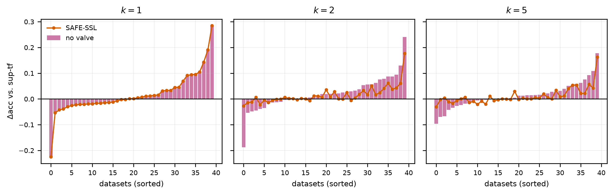

# Free Data, Costly Labels

*When does unlabeled data help time-series classification with random convolutional kernels?*

[](https://www.python.org/)
[](LICENSE)
[](configs/datasets.yaml)
[](paper/PAPER_NUMBERS.md)

Code, measurements and paper artifacts for the paper *Free Data, Costly Labels*, accepted for publication in 2026.

Labeling time series is expensive — an ECG window needs a cardiologist, a
vibration window needs a maintenance engineer — while *unlabeled* series are
essentially free, because sensors run continuously.  Yet the de-facto standard
pipeline for time-series classification, **MiniRocket + ridge**, is purely
supervised and throws unlabeled data away.

The structural observation this study is built on: **the MiniRocket transform
never looks at a label.**  Computing features for arbitrarily much unlabeled
data is therefore free, and classical semi-supervised learning (label
propagation, self-training) can be applied *directly on the feature matrix* at
near-zero cost.  For a deep model the same thing costs hours of self-supervised
pretraining.

But semi-supervised learning sometimes **hurts**.  So the question is not "does
it help?" but **"when does it help, and can we tell in advance without labels?"**

## Results at a glance

Full numbers: **[`paper/PAPER_NUMBERS.md`](paper/PAPER_NUMBERS.md)** (curated) and
[`paper/results_summary.md`](paper/results_summary.md) (exhaustive). 40 datasets x
5 budgets x 10 seeds = 2 000 cells, 16 000 rows, **0 failures**.

| | finding |
|---|---|
| RQ2 | Fitting the transform on unlabeled data is worth **+0.01 accuracy points** and is never significant. Free unlabeled *features* buy nothing. |
| RQ2 | Pseudo-labeling on the same features adds **+1.17 points** on average, positive at all 5 budgets. |
| RQ3 | `self_train` has the best mean rank at every k >= 2 (2.60 at k=5, 34/40 wins over `sup_tf`, Holm p = 2.7e-05) — but regresses on 19-41% of cells. |
| RQ4 | LFA predicts the gain with Spearman rho **-0.45 to -0.22** — **negative**, the opposite of the hypothesis, and not a headroom artefact (partial rho -0.48 to -0.29). |
| RQ5 | The labeled-data-only safety valve cuts the regression rate from **30.6% to 9.9%** and the worst-case loss from **35.5 to 18.0 points** at k >= 2. |
| RQ6 | A 52 k-parameter 1D-CNN at a 60 s/cell budget reaches **0.581** at k=5 versus **0.646** for SAFE-SSL at **39x less** compute. |

The pre-specified LFA hypothesis was rejected with the sign reversed, and it
is reported that way — see [NOTES.md](NOTES.md) §14.

<p align="center">
  
</p>

## Research questions

| | question | artifact |
|---|---|---|
| RQ1 | At `k ∈ {1,2,5,10,20}` labels per class, what fraction of the gap to the fully-supervised ceiling does each method recover? | `T3_recovery.tex`, `F2_recovery_curves` |
| RQ2 | How much of the benefit is *free unsupervised feature fitting* vs. *pseudo-labeling*? | `T2_attribution.tex`, `F4_attribution_bars` |
| RQ3 | Which SSL family wins, and does it depend on the dataset? | `F1_cd_diagrams`, `T1_main.tex` |
| RQ4 | Does our **Label-Free Alignment (LFA)** statistic predict the realised SSL gain? | `T5_lfa.tex`, `F3_lfa_scatter` |
| RQ5 | Where does SSL hurt, by how much, and how much does SAFE-SSL prevent? | `T4_safety.tex`, `F5_safety` |
| RQ6 | At matched wall-clock, does SSL-on-random-features beat a deep SSL baseline? | `F6_pareto` |

## The protocol

For a dataset with official splits `(X_tr, y_tr)`, `(X_te, y_te)`:

1. **The test set is sacred** — nothing is ever fitted on it.  Enforced by
   `tests/test_no_test_leakage.py`.
2. Sample `k` labeled instances **per class** from `y_tr`, stratified and
   seeded → index set `L`.
3. The rest of the training set is the unlabeled pool `U`; **its labels do not
   exist**.  Enforced by `tests/test_no_label_leakage.py`.

Three tiers, whose differences are the paper's decomposition:

| tier | transform fitted on | classifier fitted on |
|---|---|---|
| `SUP-strict` | `X_tr[L]` | `L` |
| `SUP-TF` | `X_tr[L ∪ U]` | `L` |
| `SSL-*` | `X_tr[L ∪ U]` | `L` + selected pseudo-labels |

`SUP-TF − SUP-strict` = value of **free unsupervised feature fitting**.
`SSL − SUP-TF` = value of **pseudo-labeling**.

## Methods

| id | description |
|---|---|
| `1nn_dtw` | 1-nearest-neighbour DTW on `L` (10% Sakoe-Chiba band), no features |
| `sup_strict` | MiniRocket(L) → `RidgeClassifierCV` on `L` |
| `sup_tf` | MiniRocket(L∪U) → `RidgeClassifierCV` on `L` |
| `self_train` | MiniRocket(L∪U) → `SelfTrainingClassifier(LogisticRegression, threshold=0.75)` |
| `label_spread` | MiniRocket(L∪U) → `LabelSpreading(knn, k=7, α=0.2)` → ridge on `L` + all propagated labels |
| `augment` | MiniRocket(L) → ridge on `L` augmented ×8 (jitter / scaling / time-warp / window-slice) |
| `safe_ssl` | **ours** — class-balanced graph pseudo-labeling with a labeled-data-only safety valve |
| `safe_ssl_novalve` | ablation arm: identical, valve removed (needed for T4) |

### SAFE-SSL

1. Standardise on `[F_L; F_U]` (scaler fitted on `L ∪ U` only).
2. Build a symmetrised cosine kNN graph (`k=7`) over `L ∪ U`.
3. Run label spreading (`α=0.2`) with unlabeled entries `-1` → soft
   distribution `P_U`.
4. **Class-balanced selection**: for each class `c`, take the top-`q` unlabeled
   points by `P_U[:,c]` among those whose argmax is `c`, with
   `q = max(1, ⌊ρ·n_U/C⌋)`, `ρ=0.25`.  A global confidence threshold instead
   selects almost exclusively the easiest/majority class and collapses — the
   dominant failure mode of naive self-training.
5. Refit `RidgeClassifierCV` on `L ∪ selected`.
6. Repeat 3–5 for `R=2` rounds, **re-selecting from scratch** each round.
   Accumulating would let a round-1 mistake stay in the training set forever and
   be reinforced.
7. **Safety valve**: estimate the accuracy of the SSL model and of `sup_tf` by
   stratified k-fold over the **labeled set only**.  If SSL does not beat
   supervised by `δ`, return the supervised model.  Using the test set to choose
   would be cheating and is blocked by a test.

### LFA — Label-Free Alignment

Computed on `F_{L∪U}` with **no labels** (only `C`, the number of classes, is
assumed known):

`sil` (silhouette of a C-means clustering) · `chi` (log Calinski–Harabasz) ·
`stab` (mean pairwise ARI over bootstrap clusterings) · `knn_purity_proxy`
(fraction of a point's 7-NN sharing its cluster).

`LFA` is the mean of the four **z-scored across datasets** — the z-scoring
happens in the analysis stage, never inside the per-dataset loop.

## Data

40 UCR datasets, selected automatically.  Scientific rules: univariate, equal
length, no missing values, `n_classes ≤ 10`, **every class has ≥ 25 training
instances** (so `k=20` leaves a non-empty unlabeled pool).  Compute-budget
rules: `n_train ≤ 1500`, `n_train+n_test ≤ 7500`, `length ≤ 2000`.

> The original protocol capped `n_train+n_test ≤ 2000` and `length ≤ 500`.  Under
> those caps only **18** of the 112 univariate equal-length UCR datasets qualify.
> The caps were relaxed to the smallest values reaching the target of 40; the
> scientific rules are unchanged.  See [NOTES.md](NOTES.md) §2.

`scripts/download_datasets.py` is the **only** file that touches the network.
If `timeseriesclassification.com` is unreachable, aeon can also read a local copy
of the archive: download the UCR archive mirror (for example
`kaggle datasets download -d aliahmedsalh/ucr-archive` or the official
`UCRArchive_2018.zip`), unzip it so that each dataset sits in
`data/_raw/<Name>/<Name>_TRAIN.ts` and `<Name>_TEST.ts`, and re-run the script —
`load_classification(..., extract_path="data/_raw")` picks up local files without
any network access, and the resulting arrays are identical in shape and dtype.

## Running it

```bash
make setup        # venv + pinned deps + editable install
make download     # ~10 min, network; writes configs/datasets.yaml
make features     # MiniRocket + scaler + graphs + DTW matrices, cached
make test         # all 10 correctness gates
make smoke        # ~2 min end-to-end sanity table
make run          # the full grid (resumable)
make lfa          # RQ4
make ablation     # the ablation grid
make deep         # optional 1D-CNN baseline for the RQ6 Pareto point
make seedcheck    # transform-seed sensitivity (validates the single feature cache)
make artifacts    # tables, figures, PAPER_NUMBERS.md, results_summary.md
```

Measured wall-clock on a 16-thread Ryzen: download ~35 min (network), features
~86 min, main grid ~53 min, ablations ~13 min, deep baseline ~48 min, artifacts
~1 min.

Every step is resumable and every step is safe to interrupt.

## Correctness gates

All ten must pass before any headline number is believed:

1. `test_no_label_leakage` — a `GuardedLabels` view raises on any read of `U`'s
   labels; a negative control proves the guard is not vacuous; corrupting the
   hidden labels must change nothing, bit for bit.
2. `test_no_test_leakage` — replacing the test features with noise must leave
   every fitted training-side object bit-identical.
3. `test_splits` — exactly `k` per class; `L ∩ U = ∅`; `L ∪ U = train`;
   same seed ⇒ same indices; infeasible budgets rejected loudly.
4. `test_balanced_selection` — on a 90/10 prior the class-balanced selector
   stays near parity while a naive threshold takes ≥95% from one class.
5. `test_methods_sanity` — ≥95% on separable data; **chance on pure noise**
   (beating chance on noise is a leak, not a method).
6. `test_features_cache` — cached == freshly computed; the cache invalidates on
   `n_kernels`, on the transform seed, and on a change of the underlying data.
7. `test_lfa` — high on separated blobs, low on one blob, permutation-invariant.
8. `test_metrics` — recovery is 0 at `sup_strict`, 1 at `sup_full`, NaN when the
   ceiling equals the floor.
9. `test_stats` — Wilcoxon and Friedman match scipy; the Nemenyi table matches
   Demšar (2006) Table 5; `CD = 1.25` for his worked example (k=4, N=14).
10. `test_determinism` — same cell, same seed, twice ⇒ bit-identical.

## Repository layout

```
configs/      datasets.yaml (generated), experiment.yaml (every constant)
scripts/      download_datasets.py · build_features.py · smoke_test.py
              run_experiments.py · run_lfa_study.py · make_paper_artifacts.py
src/tscfree/  config data splits features augment methods lfa metrics stats
              experiment utils
tests/        the ten correctness gates
results/      lfa/ and study-level JSON (shipped); raw/, ablation/, deep/ are regenerated by `make run`
paper/        tables/ figures/ results_summary.md reproducibility.json
```

## Honesty policy

* No cell is ever estimated or interpolated.  A cell that did not run is
  **missing**, is counted, and its traceback is in `results/failures/`.
* Every number in `paper/results_summary.md` is computed from files in
  `results/` by `scripts/make_paper_artifacts.py`, so the prose can never
  disagree with the tables.
* If the results contradict the thesis, `results_summary.md` says so in its
  **Verdict** section, in those words.

## Citation

The paper has been accepted; the full reference will be added here when the proceedings are published.

## License

Code is released under the [MIT License](LICENSE). The UCR archive is downloaded from timeseriesclassification.com under its own terms and is not redistributed here.
